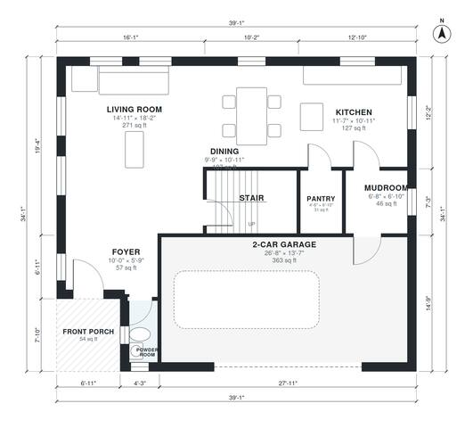

# 1800 Sq Ft 3 Bedroom House Plans: Two-Story with Garage

This is a two-story, 3-bedroom, 2.5-bath home with about 165 m² (roughly 1,780 sq ft) of living space plus an attached 2-car garage. The ground floor has an open kitchen, dining and living area, a pantry, a mudroom to the garage and a powder room. Upstairs, a central hall serves the primary suite, two more bedrooms, a hall bath and a laundry. The powder room and the primary walk-in closet are on the tight side and could be enlarged if you want.

| | |
|---|---|
| Levels | 2 |
| Footprint | 11.9 m × 10.4 m (39 ft × 34 ft) |
| Rooms | 18 indoor, 2 outdoor |
| Indoor area including garage, from the room grid | about 202 m² (2,173 sq ft) |

## Files here

- `area-schedule.csv` (room schedule)
- `building.json` (rooms, walls, openings as data)
- `plan-level1.dxf` (floor plan, DXF, drawing units: inches)
- `plan-level2.dxf` (floor plan, DXF, drawing units: inches)

## More for this plan

- Plan page with the PDF plan set, IFC and 3D model, and a tool to change the plan: https://floorplan.ai-architectures.com/house-plans/1800-sq-ft-3-bedroom-house-plans?utm_source=github-plans&utm_medium=probe&utm_campaign=github
- PDF plan set: https://storage.googleapis.com/20img/house-plans/1800-sq-ft-3-bedroom-house-plans/plan-set.pdf
- IFC model: https://storage.googleapis.com/20img/house-plans/1800-sq-ft-3-bedroom-house-plans/model.ifc

## Known issues in this drawing

- Powder Room is 1.9 m² (asked for about 3.0 m²).
- Powder Room is only 0.94 m wide.

Concept design generated with AI. Not for construction or permit; verify with a licensed professional.
