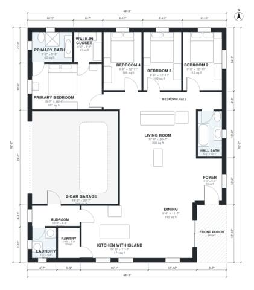

# 1800 Sq Ft 4 Bedroom House Plans: One-Story with Garage

This is a single-story, 4-bedroom, 2-bath modern farmhouse of about 167 m² (1,800 sq ft) of living space, plus a 2-car garage and a front porch. The kitchen with island, dining and living areas form one large open space. A mudroom and laundry sit between the garage and kitchen. The primary suite, with its bath and walk-in closet, is separate from the three secondary bedrooms, which share a hall bath.

| | |
|---|---|
| Levels | 1 |
| Footprint | 13.5 m × 15.9 m (44 ft × 52 ft) |
| Rooms | 16 indoor, 1 outdoor |
| Indoor area including garage, from the room grid | about 207 m² (2,227 sq ft) |

## Files here

- `area-schedule.csv` (room schedule)
- `building.json` (rooms, walls, openings as data)
- `plan-level1.dxf` (floor plan, DXF, drawing units: inches)

## More for this plan

- Plan page with the PDF plan set, IFC and 3D model, and a tool to change the plan: https://floorplan.ai-architectures.com/house-plans/1800-sq-ft-4-bedroom-house-plans?utm_source=github-plans&utm_medium=probe&utm_campaign=github
- PDF plan set: https://storage.googleapis.com/20img/house-plans/1800-sq-ft-4-bedroom-house-plans/plan-set.pdf
- IFC model: https://storage.googleapis.com/20img/house-plans/1800-sq-ft-4-bedroom-house-plans/model.ifc

## Known issues in this drawing

- Laundry is 3.3 m² (asked for about 5.0 m²).
- Living Room has no window.
- Foyer is 4.7 m² (asked for about 7.0 m²).

Concept design generated with AI. Not for construction or permit; verify with a licensed professional.
