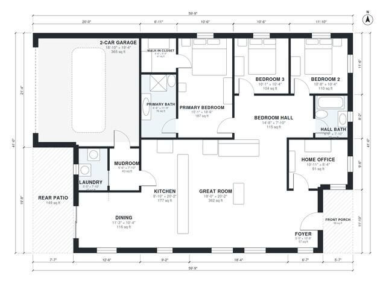

# 1800 Sq Ft House Plans: 3-Bed Single-Story With Office

This single-story ranch has about 1,800 sq ft of heated space (167 m²) plus a 2-car garage, a front porch and a rear patio. The kitchen, dining and great room form one open space at the center. The primary suite and two more bedrooms sit along a private hall. The home office is off the foyer, and a mudroom with the laundry links the garage to the kitchen.

| | |
|---|---|
| Levels | 1 |
| Footprint | 18.2 m × 12.5 m (60 ft × 41 ft) |
| Rooms | 15 indoor, 2 outdoor |
| Indoor area including garage, from the room grid | about 208 m² (2,234 sq ft) |

## Files here

- `area-schedule.csv` (room schedule)
- `building.json` (rooms, walls, openings as data)
- `plan-level1.dxf` (floor plan, DXF, drawing units: inches)

## More for this plan

- Plan page with the PDF plan set, IFC and 3D model, and a tool to change the plan: https://floorplan.ai-architectures.com/house-plans/1800-sq-ft-house-plans?utm_source=github-plans&utm_medium=probe&utm_campaign=github
- PDF plan set: https://storage.googleapis.com/20img/house-plans/1800-sq-ft-house-plans/plan-set.pdf
- IFC model: https://storage.googleapis.com/20img/house-plans/1800-sq-ft-house-plans/model.ifc

## Known issues in this drawing

- None found by the automatic checks.

Concept design generated with AI. Not for construction or permit; verify with a licensed professional.
