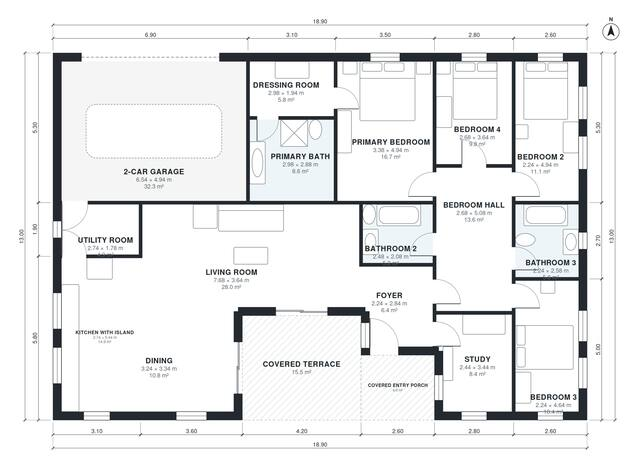

# 190 Square Meter House Plans: 4 Bed, 3 Bath L-Shaped Bungalow

A single-storey L-shaped bungalow of about 190 m² of living space, plus a 2-car garage, covered terrace and entry porch. An open kitchen-dining-living wing faces the garden terrace. A separate bedroom wing holds four bedrooms, two bathrooms and a primary suite with a dressing room and ensuite. We are rebalancing room sizes to give the bedrooms and the dining area more width.

| | |
|---|---|
| Levels | 1 |
| Footprint | 18.9 m × 13.0 m (62 ft × 43 ft) |
| Rooms | 16 indoor, 2 outdoor |
| Indoor area including garage, from the room grid | about 224 m² (2,413 sq ft) |

## Files here

- `area-schedule.csv` (room schedule)
- `building.json` (rooms, walls, openings as data)
- `plan-level1.dxf` (floor plan, DXF, drawing units: millimetres)

## More for this plan

- Plan page with the PDF plan set, IFC and 3D model, and a tool to change the plan: https://floorplan.ai-architectures.com/house-plans/190-square-meter-house-plans?utm_source=github-plans&utm_medium=probe&utm_campaign=github
- PDF plan set: https://storage.googleapis.com/20img/house-plans/190-square-meter-house-plans/plan-set.pdf
- IFC model: https://storage.googleapis.com/20img/house-plans/190-square-meter-house-plans/model.ifc

## Known issues in this drawing

- Bedroom 3 is only 2.24 m wide.
- Bedroom 2 is only 2.24 m wide.

Concept design generated with AI. Not for construction or permit; verify with a licensed professional.
