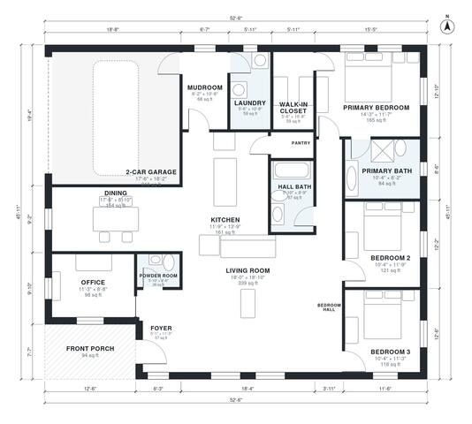

# 1900 Sq Ft House Plans: 1,960 Sq Ft, 3 Bed, 2.5 Bath One-Story

This is a single-story modern farmhouse of about 1,900 sq ft of living space, plus an attached 2-car garage and a front porch. The kitchen, dining and living areas form one open space at the center. The private primary suite sits at the back, and the two secondary bedrooms and a hall bath are along the east side. The front entry has an office and powder room, and the mudroom and laundry link the garage to the kitchen.

| | |
|---|---|
| Levels | 1 |
| Footprint | 16.0 m × 14.0 m (52 ft × 46 ft) |
| Rooms | 17 indoor, 1 outdoor |
| Indoor area including garage, from the room grid | about 215 m² (2,317 sq ft) |

## Files here

- `area-schedule.csv` (room schedule)
- `building.json` (rooms, walls, openings as data)
- `plan-level1.dxf` (floor plan, DXF, drawing units: inches)

## More for this plan

- Plan page with the PDF plan set, IFC and 3D model, and a tool to change the plan: https://floorplan.ai-architectures.com/house-plans/1900-sq-ft-house-plans?utm_source=github-plans&utm_medium=probe&utm_campaign=github
- PDF plan set: https://storage.googleapis.com/20img/house-plans/1900-sq-ft-house-plans/plan-set.pdf
- IFC model: https://storage.googleapis.com/20img/house-plans/1900-sq-ft-house-plans/model.ifc

## Known issues in this drawing

- Kitchen has no window.

Concept design generated with AI. Not for construction or permit; verify with a licensed professional.
