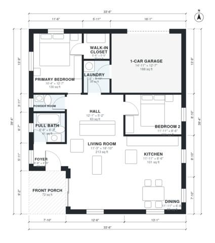

# 2 Bedroom 1.5 Bath House Plans: 1,020 Sq Ft Single-Story

This single-story home has about 100 m² (1,100 sq ft) of living space, plus a 22 m² attached 1-car garage. The front porch leads into a foyer and an open kitchen, living and dining area. A short hall off the living room leads to the two bedrooms, the full bath and the powder room. The laundry sits between the hall and the garage, so groceries and daily traffic can come in without crossing the main living space.

| | |
|---|---|
| Levels | 1 |
| Footprint | 10.2 m × 12.0 m (33 ft × 39 ft) |
| Rooms | 12 indoor, 1 outdoor |
| Indoor area including garage, from the room grid | about 116 m² (1,245 sq ft) |

## Files here

- `area-schedule.csv` (room schedule)
- `building.json` (rooms, walls, openings as data)
- `plan-level1.dxf` (floor plan, DXF, drawing units: inches)

## More for this plan

- Plan page with the PDF plan set, IFC and 3D model, and a tool to change the plan: https://floorplan.ai-architectures.com/house-plans/2-bedroom-1-5-bath-house-plans?utm_source=github-plans&utm_medium=probe&utm_campaign=github
- PDF plan set: https://storage.googleapis.com/20img/house-plans/2-bedroom-1-5-bath-house-plans/plan-set.pdf
- IFC model: https://storage.googleapis.com/20img/house-plans/2-bedroom-1-5-bath-house-plans/model.ifc

## Known issues in this drawing

- Hall and Full Bath are not directly connected.
- Foyer is 2.9 m² (asked for about 4.0 m²).
- Dining is only 2.04 m wide.

Concept design generated with AI. Not for construction or permit; verify with a licensed professional.
