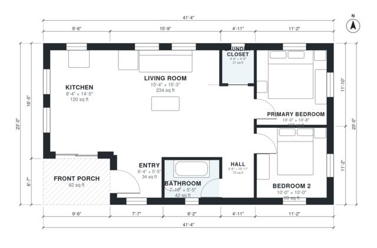

# 2 Bedroom 1 Bath House Plans: 890 Sq Ft Single-Story Plan

This is a compact single-story cottage of about 900 sq ft of living space (roughly 83 m²), plus a covered front porch. The porch and entry lead into a bright open kitchen and living room. A short hall at the east end serves two bedrooms, a full bath and a laundry closet, which keeps the sleeping areas private from the living space.

| | |
|---|---|
| Levels | 1 |
| Footprint | 12.6 m × 7.0 m (41 ft × 23 ft) |
| Rooms | 8 indoor, 1 outdoor |
| Indoor area including garage, from the room grid | about 82 m² (887 sq ft) |

## Files here

- `area-schedule.csv` (room schedule)
- `building.json` (rooms, walls, openings as data)
- `plan-level1.dxf` (floor plan, DXF, drawing units: inches)

## More for this plan

- Plan page with the PDF plan set, IFC and 3D model, and a tool to change the plan: https://floorplan.ai-architectures.com/house-plans/2-bedroom-1-bath-house-plans?utm_source=github-plans&utm_medium=probe&utm_campaign=github
- PDF plan set: https://storage.googleapis.com/20img/house-plans/2-bedroom-1-bath-house-plans/plan-set.pdf
- IFC model: https://storage.googleapis.com/20img/house-plans/2-bedroom-1-bath-house-plans/model.ifc

## Known issues in this drawing

- Entry is 3.2 m² (asked for about 5.0 m²).

Concept design generated with AI. Not for construction or permit; verify with a licensed professional.
