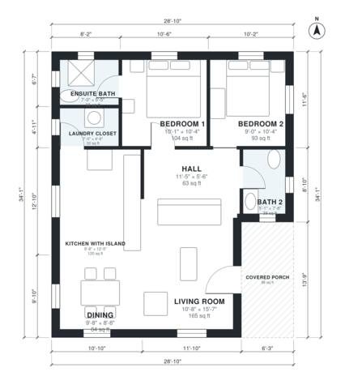

# 2 Bedroom 2 Bath ADU Plans: 900 Sq Ft Detached Backyard Unit

This is a single-level detached ADU of about 880 sq ft (about 82 m²) plus a covered front porch. You enter through the porch into an open living, dining and kitchen area with an island. Two bedrooms sit on the quiet side of the plan, each with its own bath (one ensuite), and a laundry closet is tucked beside Bedroom 1.

| | |
|---|---|
| Levels | 1 |
| Footprint | 8.8 m × 10.4 m (29 ft × 34 ft) |
| Rooms | 9 indoor, 1 outdoor |
| Indoor area including garage, from the room grid | about 84 m² (899 sq ft) |

## Files here

- `area-schedule.csv` (room schedule)
- `building.json` (rooms, walls, openings as data)
- `plan-level1.dxf` (floor plan, DXF, drawing units: inches)

## More for this plan

- Plan page with the PDF plan set, IFC and 3D model, and a tool to change the plan: https://floorplan.ai-architectures.com/house-plans/2-bedroom-2-bath-adu-plans?utm_source=github-plans&utm_medium=probe&utm_campaign=github
- PDF plan set: https://storage.googleapis.com/20img/house-plans/2-bedroom-2-bath-adu-plans/plan-set.pdf
- IFC model: https://storage.googleapis.com/20img/house-plans/2-bedroom-2-bath-adu-plans/model.ifc

## Known issues in this drawing

- Bath 2 is 3.6 m² (asked for about 5.0 m²).
- Ensuite Bath is 3.5 m² (asked for about 5.0 m²).

Concept design generated with AI. Not for construction or permit; verify with a licensed professional.
