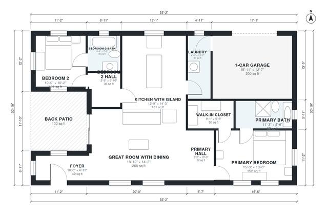

# 2 Bedroom 2 Bath House Plans: 1,270 Sq Ft One-Story Design

A single-story split-bedroom home of about 152 m² including the garage and patio, with roughly 1,250 sq ft of living space. A central open great room and island kitchen, with a dining zone built into the great room, sit between the primary suite (bath and walk-in closet) and Bedroom 2 (own bath). The 1-car garage enters through the laundry into the kitchen, and the back patio opens off the great room.

| | |
|---|---|
| Levels | 1 |
| Footprint | 16.2 m × 9.4 m (53 ft × 31 ft) |
| Rooms | 12 indoor, 1 outdoor |
| Indoor area including garage, from the room grid | about 140 m² (1,507 sq ft) |

## Files here

- `area-schedule.csv` (room schedule)
- `building.json` (rooms, walls, openings as data)
- `plan-level1.dxf` (floor plan, DXF, drawing units: inches)

## More for this plan

- Plan page with the PDF plan set, IFC and 3D model, and a tool to change the plan: https://floorplan.ai-architectures.com/house-plans/2-bedroom-2-bath-house-plans?utm_source=github-plans&utm_medium=probe&utm_campaign=github
- PDF plan set: https://storage.googleapis.com/20img/house-plans/2-bedroom-2-bath-house-plans/plan-set.pdf
- IFC model: https://storage.googleapis.com/20img/house-plans/2-bedroom-2-bath-house-plans/model.ifc

## Known issues in this drawing

- Foyer is 4.6 m² (asked for about 7.0 m²).

Concept design generated with AI. Not for construction or permit; verify with a licensed professional.
