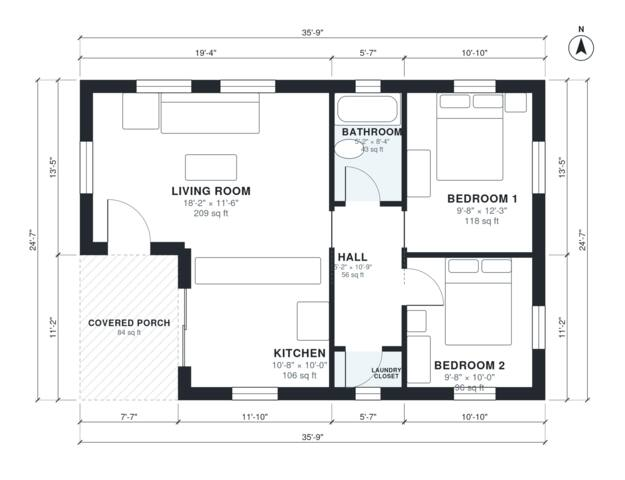

# 2 Bedroom ADU Plans: 800 Sq Ft Detached Single-Level Design

This is a compact single-storey 2-bedroom, 1-bath ADU of about 800 sq ft indoors, plus an 84 sq ft covered porch. The front door opens from the porch into an open living and kitchen area. A central hall serves the two bedrooms, the full bathroom and the laundry closet, so the sleeping areas stay private and every room has daylight.

| | |
|---|---|
| Levels | 1 |
| Footprint | 10.9 m × 7.5 m (36 ft × 25 ft) |
| Rooms | 7 indoor, 1 outdoor |
| Indoor area including garage, from the room grid | about 74 m² (796 sq ft) |

## Files here

- `building.json` (rooms, walls, openings as data)
- `plan-level1.dxf` (floor plan, DXF, drawing units: inches)

## More for this plan

- Plan page with the PDF plan set, IFC and 3D model, and a tool to change the plan: https://floorplan.ai-architectures.com/house-plans/2-bedroom-adu-plans?utm_source=github-plans&utm_medium=probe&utm_campaign=github
- PDF plan set: https://storage.googleapis.com/20img/house-plans/2-bedroom-adu-plans/plan-set.pdf
- IFC model: https://storage.googleapis.com/20img/house-plans/2-bedroom-adu-plans/model.ifc

## Known issues in this drawing

- None found by the automatic checks.

Concept design generated with AI. Not for construction or permit; verify with a licensed professional.
