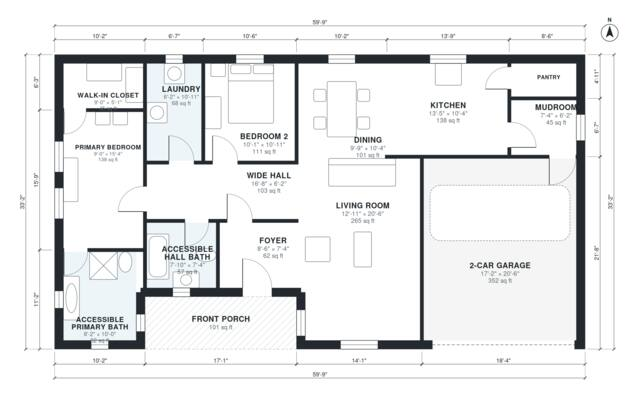

# 2 Bedroom Aging in Place House Plans, 1,480 Sq Ft One-Story

This is a single-story, zero-step ranch of about 140 m² (1,500 sq ft) of living space. It has two bedrooms and two accessible baths, plus a 2-car garage and a front porch outside that figure. The open kitchen, dining and living area sits at the front and centre, and the wide hall leads to the primary suite, with the laundry right beside it. A second bedroom and hall bath are also off the hall. The primary bedroom and bath came out a bit tighter than planned, and we can widen them on request.

| | |
|---|---|
| Levels | 1 |
| Footprint | 18.2 m × 10.1 m (60 ft × 33 ft) |
| Rooms | 14 indoor, 1 outdoor |
| Indoor area including garage, from the room grid | about 174 m² (1,878 sq ft) |

## Files here

- `area-schedule.csv` (room schedule)
- `building.json` (rooms, walls, openings as data)
- `plan-level1.dxf` (floor plan, DXF, drawing units: inches)

## More for this plan

- Plan page with the PDF plan set, IFC and 3D model, and a tool to change the plan: https://floorplan.ai-architectures.com/house-plans/2-bedroom-aging-in-place-house-plans?utm_source=github-plans&utm_medium=probe&utm_campaign=github
- PDF plan set: https://storage.googleapis.com/20img/house-plans/2-bedroom-aging-in-place-house-plans/plan-set.pdf
- IFC model: https://storage.googleapis.com/20img/house-plans/2-bedroom-aging-in-place-house-plans/model.ifc

## Known issues in this drawing

- Primary Bedroom is only 2.74 m wide.

Concept design generated with AI. Not for construction or permit; verify with a licensed professional.
