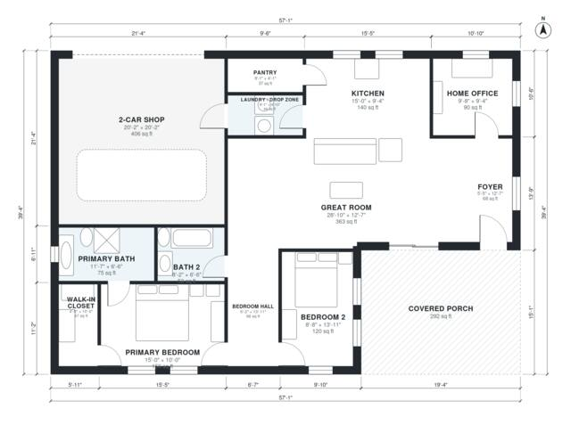

# 2 Bedroom Barndominium Floor Plans: 1,500 Sq Ft With Shop

This single-story barndominium has about 1,500 sq ft of living space. A wide covered porch leads into a foyer and a large open great room and kitchen. The home office is off the foyer. The bedroom wing has the primary suite, with a bath and walk-in closet, plus a second bedroom and a full bath. A laundry and drop zone connects the kitchen to the attached 2-car shop.

| | |
|---|---|
| Levels | 1 |
| Footprint | 17.4 m × 12.0 m (57 ft × 39 ft) |
| Rooms | 13 indoor, 1 outdoor |
| Indoor area including garage, from the room grid | about 182 m² (1,955 sq ft) |

## Files here

- `area-schedule.csv` (room schedule)
- `building.json` (rooms, walls, openings as data)
- `plan-level1.dxf` (floor plan, DXF, drawing units: inches)

## More for this plan

- Plan page with the PDF plan set, IFC and 3D model, and a tool to change the plan: https://floorplan.ai-architectures.com/house-plans/2-bedroom-barndominium-floor-plans?utm_source=github-plans&utm_medium=probe&utm_campaign=github
- PDF plan set: https://storage.googleapis.com/20img/house-plans/2-bedroom-barndominium-floor-plans/plan-set.pdf
- IFC model: https://storage.googleapis.com/20img/house-plans/2-bedroom-barndominium-floor-plans/model.ifc

## Known issues in this drawing

- Great Room is only 3.84 m wide.

Concept design generated with AI. Not for construction or permit; verify with a licensed professional.
