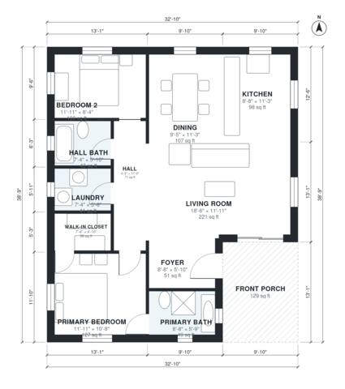

# 2 Bedroom Bungalow House Plans: 1,140 Sq Ft with Porch

This is a single-story craftsman bungalow of about 106 m² (1,150 sq ft) of living space, with a 12 m² covered front porch in addition. You enter through the porch and foyer into an open living, dining and kitchen area. A short hall serves the second bedroom, hall bath and laundry. The primary suite sits at the front corner with its own bath and walk-in closet.

| | |
|---|---|
| Levels | 1 |
| Footprint | 10.0 m × 11.8 m (33 ft × 39 ft) |
| Rooms | 11 indoor, 1 outdoor |
| Indoor area including garage, from the room grid | about 106 m² (1,141 sq ft) |

## Files here

- `area-schedule.csv` (room schedule)
- `building.json` (rooms, walls, openings as data)
- `plan-level1.dxf` (floor plan, DXF, drawing units: inches)

## More for this plan

- Plan page with the PDF plan set, IFC and 3D model, and a tool to change the plan: https://floorplan.ai-architectures.com/house-plans/2-bedroom-bungalow-house-plans?utm_source=github-plans&utm_medium=probe&utm_campaign=github
- PDF plan set: https://storage.googleapis.com/20img/house-plans/2-bedroom-bungalow-house-plans/plan-set.pdf
- IFC model: https://storage.googleapis.com/20img/house-plans/2-bedroom-bungalow-house-plans/model.ifc

## Known issues in this drawing

- None found by the automatic checks.

Concept design generated with AI. Not for construction or permit; verify with a licensed professional.
