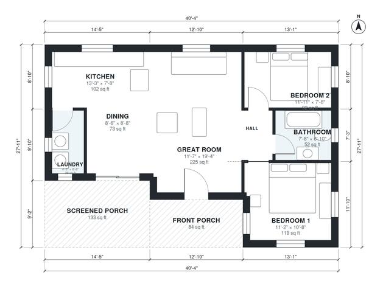

# 2 Bedroom Cabin Plans: 910 Sq Ft Single-Story Layout

This is a compact single-story cabin of about 84 m² (900 sq ft) of living space, plus a front porch and a screened porch. The open great room, kitchen and dining area run along the front and west of the plan. The two bedrooms and the bath sit together off a short hall on the east side. The laundry is tucked in beside the dining area, and the screened porch extends the living space outdoors.

| | |
|---|---|
| Levels | 1 |
| Footprint | 12.3 m × 8.5 m (40 ft × 28 ft) |
| Rooms | 8 indoor, 2 outdoor |
| Indoor area including garage, from the room grid | about 84 m² (909 sq ft) |

## Files here

- `area-schedule.csv` (room schedule)
- `building.json` (rooms, walls, openings as data)
- `plan-level1.dxf` (floor plan, DXF, drawing units: inches)

## More for this plan

- Plan page with the PDF plan set, IFC and 3D model, and a tool to change the plan: https://floorplan.ai-architectures.com/house-plans/2-bedroom-cabin-plans?utm_source=github-plans&utm_medium=probe&utm_campaign=github
- PDF plan set: https://storage.googleapis.com/20img/house-plans/2-bedroom-cabin-plans/plan-set.pdf
- IFC model: https://storage.googleapis.com/20img/house-plans/2-bedroom-cabin-plans/model.ifc

## Known issues in this drawing

- Dining is only 2.58 m wide.
- Bedroom 2 is only 2.34 m wide.

Concept design generated with AI. Not for construction or permit; verify with a licensed professional.
