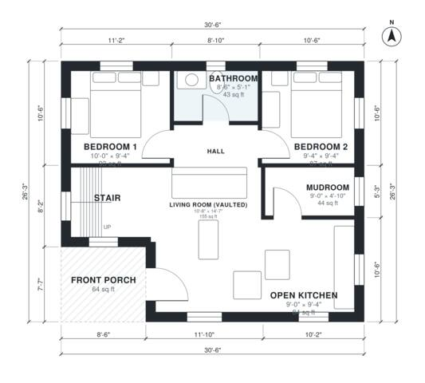

# 2 Bedroom Cabin with Loft: 1,030 Sq Ft, 1 Bath Floor Plan

This is a compact two-storey cabin of about 95 m² (about 1,000 sq ft) of living space, plus a covered front porch. The ground floor has an open kitchen and living area, two bedrooms off a short hall, a bath and a mudroom with its own outside door. An open sleeping loft sits above, reached by a stair from the living room.

| | |
|---|---|
| Levels | 2 |
| Footprint | 9.3 m × 8.0 m (31 ft × 26 ft) |
| Rooms | 10 indoor, 2 outdoor |
| Indoor area including garage, from the room grid | about 95 m² (1,027 sq ft) |

## Files here

- `area-schedule.csv` (room schedule)
- `building.json` (rooms, walls, openings as data)
- `plan-level1.dxf` (floor plan, DXF, drawing units: inches)
- `plan-level2.dxf` (floor plan, DXF, drawing units: inches)

## More for this plan

- Plan page with the PDF plan set, IFC and 3D model, and a tool to change the plan: https://floorplan.ai-architectures.com/house-plans/2-bedroom-cabin-with-loft?utm_source=github-plans&utm_medium=probe&utm_campaign=github
- PDF plan set: https://storage.googleapis.com/20img/house-plans/2-bedroom-cabin-with-loft/plan-set.pdf
- IFC model: https://storage.googleapis.com/20img/house-plans/2-bedroom-cabin-with-loft/model.ifc

## Known issues in this drawing

- Sleeping Loft is only 2.30 m wide.

Concept design generated with AI. Not for construction or permit; verify with a licensed professional.
