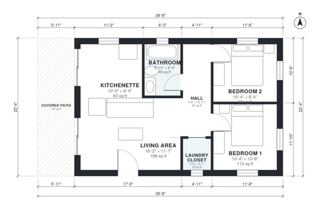

# 2 Bedroom Casita Floor Plans: 750 Sq Ft Spanish Guest House

This is a compact one-story Spanish-style casita of about 750 sq ft indoors, plus a roughly 130 sq ft covered patio, in a 39'8" x 22'4" footprint. The front door opens into a bright living area that is open to the kitchenette, and sliding glazing leads out to the shaded patio. A short hall serves two bedrooms, a full bath and a laundry closet.

| | |
|---|---|
| Levels | 1 |
| Footprint | 12.1 m × 6.8 m (40 ft × 22 ft) |
| Rooms | 7 indoor, 1 outdoor |
| Indoor area including garage, from the room grid | about 70 m² (754 sq ft) |

## Files here

- `area-schedule.csv` (room schedule)
- `building.json` (rooms, walls, openings as data)
- `plan-level1.dxf` (floor plan, DXF, drawing units: inches)

## More for this plan

- Plan page with the PDF plan set, IFC and 3D model, and a tool to change the plan: https://floorplan.ai-architectures.com/house-plans/2-bedroom-casita-floor-plans?utm_source=github-plans&utm_medium=probe&utm_campaign=github
- PDF plan set: https://storage.googleapis.com/20img/house-plans/2-bedroom-casita-floor-plans/plan-set.pdf
- IFC model: https://storage.googleapis.com/20img/house-plans/2-bedroom-casita-floor-plans/model.ifc

## Known issues in this drawing

- None found by the automatic checks.

Concept design generated with AI. Not for construction or permit; verify with a licensed professional.
