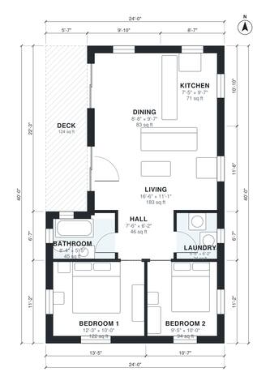

# 2 Bedroom Container Home Plans: 840 Sq Ft, 3 Containers

This 960 sq ft (about 89 m²) container home uses three 40 ft containers side by side. The front door opens into an open living, dining and kitchen area with a deck on the west side. A short hall leads to two bedrooms, a full bathroom and a laundry closet. The layout is compact with good daylight and clear separation between public and private zones.

| | |
|---|---|
| Levels | 1 |
| Footprint | 7.32 m × 12.19 m (24 ft × 40 ft) |
| Rooms | 8 indoor, 1 outdoor |
| Indoor area including garage, from the room grid | about 78 m² (836 sq ft) |

## Files here

- `area-schedule.csv` (room schedule)
- `building.json` (rooms, walls, openings as data)
- `plan-level1.dxf` (floor plan, DXF, drawing units: inches)

## More for this plan

- Plan page with the PDF plan set, IFC and 3D model, and a tool to change the plan: https://floorplan.ai-architectures.com/house-plans/2-bedroom-container-home-plans?utm_source=github-plans&utm_medium=probe&utm_campaign=github
- PDF plan set: https://storage.googleapis.com/20img/house-plans/2-bedroom-container-home-plans/plan-set.pdf
- IFC model: https://storage.googleapis.com/20img/house-plans/2-bedroom-container-home-plans/model.ifc

## Known issues in this drawing

- Kitchen is 6.6 m² (asked for about 11.0 m²).

Concept design generated with AI. Not for construction or permit; verify with a licensed professional.
