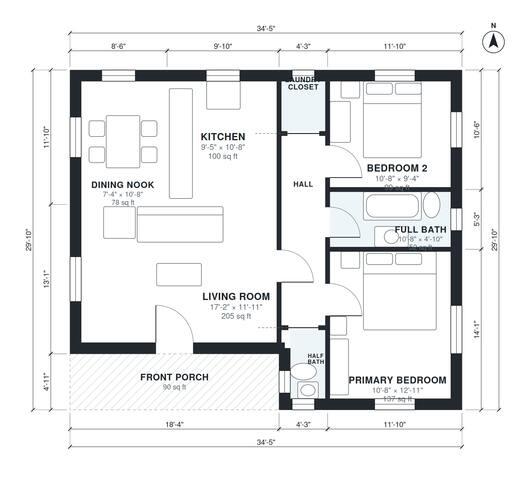

# 2 Bedroom Cottage Plans: 940 Sq Ft One-Story with Front Porch

This is a compact one-story 2-bedroom cottage of about 950 sq ft (about 88 m²) indoors, plus a covered front porch. You enter through the porch into a bright open living, kitchen and dining nook. A short hall leads to the primary bedroom, the second bedroom, a full bath, a half bath and a laundry closet. The kitchen is on the snug side, so we can widen it if you want.

| | |
|---|---|
| Levels | 1 |
| Footprint | 10.5 m × 9.1 m (34 ft × 30 ft) |
| Rooms | 9 indoor, 1 outdoor |
| Indoor area including garage, from the room grid | about 87 m² (938 sq ft) |

## Files here

- `area-schedule.csv` (room schedule)
- `building.json` (rooms, walls, openings as data)
- `plan-level1.dxf` (floor plan, DXF, drawing units: inches)

## More for this plan

- Plan page with the PDF plan set, IFC and 3D model, and a tool to change the plan: https://floorplan.ai-architectures.com/house-plans/2-bedroom-cottage-plans?utm_source=github-plans&utm_medium=probe&utm_campaign=github
- PDF plan set: https://storage.googleapis.com/20img/house-plans/2-bedroom-cottage-plans/plan-set.pdf
- IFC model: https://storage.googleapis.com/20img/house-plans/2-bedroom-cottage-plans/model.ifc

## Known issues in this drawing

- None found by the automatic checks.

Concept design generated with AI. Not for construction or permit; verify with a licensed professional.
