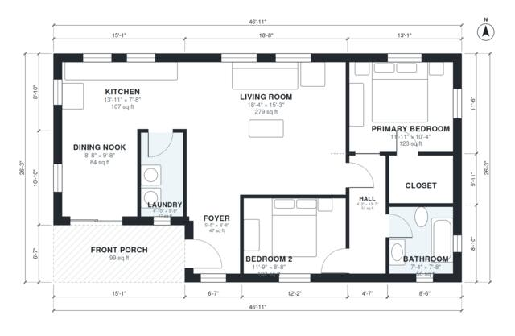

# 2 Bedroom Craftsman House Plans: 1,130 Sq Ft One-Story

This is a single-story craftsman cottage of about 105 m² (about 1,130 sq ft) of interior space, plus a covered front porch. The entry foyer opens to an open-plan living room, kitchen and dining nook, with a laundry beside the kitchen. A hall at the east end serves a primary bedroom with its own closet, a second bedroom and a full bath. No garage is included.

| | |
|---|---|
| Levels | 1 |
| Footprint | 14.3 m × 8.0 m (47 ft × 26 ft) |
| Rooms | 10 indoor, 1 outdoor |
| Indoor area including garage, from the room grid | about 105 m² (1,132 sq ft) |

## Files here

- `area-schedule.csv` (room schedule)
- `building.json` (rooms, walls, openings as data)
- `plan-level1.dxf` (floor plan, DXF, drawing units: inches)

## More for this plan

- Plan page with the PDF plan set, IFC and 3D model, and a tool to change the plan: https://floorplan.ai-architectures.com/house-plans/2-bedroom-craftsman-house-plans?utm_source=github-plans&utm_medium=probe&utm_campaign=github
- PDF plan set: https://storage.googleapis.com/20img/house-plans/2-bedroom-craftsman-house-plans/plan-set.pdf
- IFC model: https://storage.googleapis.com/20img/house-plans/2-bedroom-craftsman-house-plans/model.ifc

## Known issues in this drawing

- None found by the automatic checks.

Concept design generated with AI. Not for construction or permit; verify with a licensed professional.
