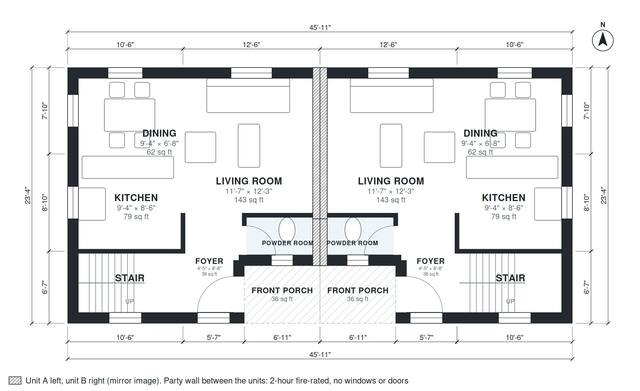

# 2 Bedroom Duplex Plans: Two-Story Side-by-Side, 2,070 Sq Ft

Each of the two mirrored townhouse units is about 1,050 sq ft (98 m²) over two floors, with its own front porch and foyer and a shared fire-rated party wall. Downstairs is an open kitchen, dining and living area with a powder room beside the stair. Upstairs are two bedrooms, a bath and a laundry, all off one hall. The dining area is compact, and we can widen it by trimming the living room if you want. Two mirrored units side by side, each with its own entrance, kitchen, bathrooms and stair where there are upper floors; the party wall between them is a fire wall without openings.

| | |
|---|---|
| Levels | 2 |
| Footprint | 14.0 m × 7.1 m (46 ft × 23 ft) |
| Rooms | 24 indoor, 2 outdoor |
| Indoor area including garage, from the room grid | about 192 m² (2,068 sq ft) |

## Files here

- `area-schedule.csv` (room schedule)
- `building.json` (rooms, walls, openings as data)
- `plan-level1.dxf` (floor plan, DXF, drawing units: inches)
- `plan-level2.dxf` (floor plan, DXF, drawing units: inches)

## More for this plan

- Plan page with the PDF plan set, IFC and 3D model, and a tool to change the plan: https://floorplan.ai-architectures.com/house-plans/2-bedroom-duplex-plans?utm_source=github-plans&utm_medium=probe&utm_campaign=github
- PDF plan set: https://storage.googleapis.com/20img/house-plans/2-bedroom-duplex-plans/plan-set.pdf
- IFC model: https://storage.googleapis.com/20img/house-plans/2-bedroom-duplex-plans/model.ifc

## Known issues in this drawing

- Dining is 5.8 m² (asked for about 8.0 m²).
- Dining is only 2.04 m wide.
- Dining is 5.8 m² (asked for about 8.0 m²).
- Dining is only 2.04 m wide.

Concept design generated with AI. Not for construction or permit; verify with a licensed professional.
