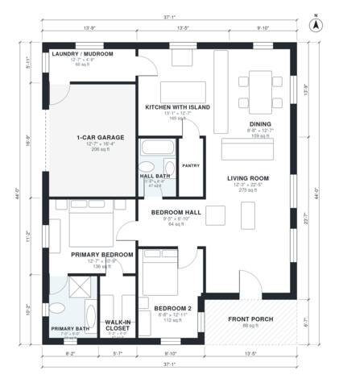

# 2 Bedroom Farmhouse Plans: 1,310 Sq Ft, 2 Bath, 1-Car Garage

This is a single-story modern farmhouse with about 121 m² (1,300 sq ft) of living space. The garage (22 m²) and front porch (8 m²) are extra. A large open kitchen, dining and living area has a farmhouse-sink island and a pantry. The laundry/mudroom connects the kitchen to the 1-car garage. The primary suite has an ensuite bath and a walk-in closet. Bedroom 2 and the hall bath sit off the bedroom hall.

| | |
|---|---|
| Levels | 1 |
| Footprint | 11.3 m × 13.4 m (37 ft × 44 ft) |
| Rooms | 12 indoor, 1 outdoor |
| Indoor area including garage, from the room grid | about 143 m² (1,542 sq ft) |

## Files here

- `area-schedule.csv` (room schedule)
- `building.json` (rooms, walls, openings as data)
- `plan-level1.dxf` (floor plan, DXF, drawing units: inches)

## More for this plan

- Plan page with the PDF plan set, IFC and 3D model, and a tool to change the plan: https://floorplan.ai-architectures.com/house-plans/2-bedroom-farmhouse-plans?utm_source=github-plans&utm_medium=probe&utm_campaign=github
- PDF plan set: https://storage.googleapis.com/20img/house-plans/2-bedroom-farmhouse-plans/plan-set.pdf
- IFC model: https://storage.googleapis.com/20img/house-plans/2-bedroom-farmhouse-plans/model.ifc

## Known issues in this drawing

- None found by the automatic checks.

Concept design generated with AI. Not for construction or permit; verify with a licensed professional.
