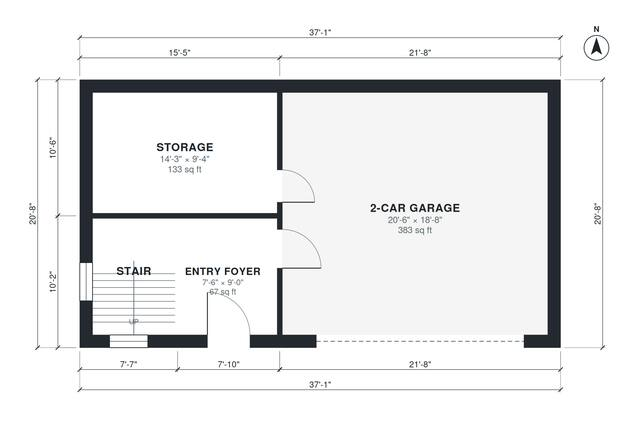

# 2 Bedroom Garage Apartment Plans: 1,090 Sq Ft, 2-Car Garage

This is a compact two-story garage apartment of about 142 m² (1,530 sq ft) in total, with a 37'-1" x 20'-8" footprint. The ground floor holds a 2-car garage, a storage room and an entry foyer at the foot of the stair. Upstairs is an apartment of about 764 sq ft with an open kitchen and living area, two bedrooms at opposite ends, a shared bath and a laundry, all off a short hall.

| | |
|---|---|
| Levels | 2 |
| Footprint | 11.3 m × 6.3 m (37 ft × 21 ft) |
| Rooms | 12 indoor, 0 outdoor |
| Indoor area including garage, from the room grid | about 142 m² (1,533 sq ft) |

## Files here

- `area-schedule.csv` (room schedule)
- `building.json` (rooms, walls, openings as data)
- `plan-level1.dxf` (floor plan, DXF, drawing units: inches)
- `plan-level2.dxf` (floor plan, DXF, drawing units: inches)

## More for this plan

- Plan page with the PDF plan set, IFC and 3D model, and a tool to change the plan: https://floorplan.ai-architectures.com/house-plans/2-bedroom-garage-apartment-plans?utm_source=github-plans&utm_medium=probe&utm_campaign=github
- PDF plan set: https://storage.googleapis.com/20img/house-plans/2-bedroom-garage-apartment-plans/plan-set.pdf
- IFC model: https://storage.googleapis.com/20img/house-plans/2-bedroom-garage-apartment-plans/model.ifc

## Known issues in this drawing

- 2-Car Garage is only 5.70 m wide.
- Living Room is only 2.74 m wide.

Concept design generated with AI. Not for construction or permit; verify with a licensed professional.
