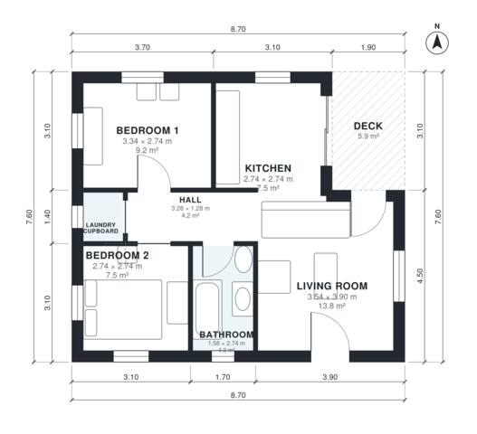

# 2 Bedroom Granny Flat Plans: 650 Sq Ft, 1 Bath Layout

A compact single-storey two-bedroom home of about 60 m² of living space, plus a 5.9 m² deck, on an 8.7 x 7.6 m footprint. The front door opens into an open kitchen and living area that has a sliding door to the deck. A short hall leads to two bedrooms, the bathroom and a laundry cupboard.

| | |
|---|---|
| Levels | 1 |
| Footprint | 8.7 m × 7.6 m (29 ft × 25 ft) |
| Rooms | 7 indoor, 1 outdoor |
| Indoor area including garage, from the room grid | about 60 m² (648 sq ft) |

## Files here

- `area-schedule.csv` (room schedule)
- `building.json` (rooms, walls, openings as data)
- `plan-level1.dxf` (floor plan, DXF, drawing units: millimetres)

## More for this plan

- Plan page with the PDF plan set, IFC and 3D model, and a tool to change the plan: https://floorplan.ai-architectures.com/house-plans/2-bedroom-granny-flat-plans?utm_source=github-plans&utm_medium=probe&utm_campaign=github
- PDF plan set: https://storage.googleapis.com/20img/house-plans/2-bedroom-granny-flat-plans/plan-set.pdf
- IFC model: https://storage.googleapis.com/20img/house-plans/2-bedroom-granny-flat-plans/model.ifc

## Known issues in this drawing

- None found by the automatic checks.

Concept design generated with AI. Not for construction or permit; verify with a licensed professional.
