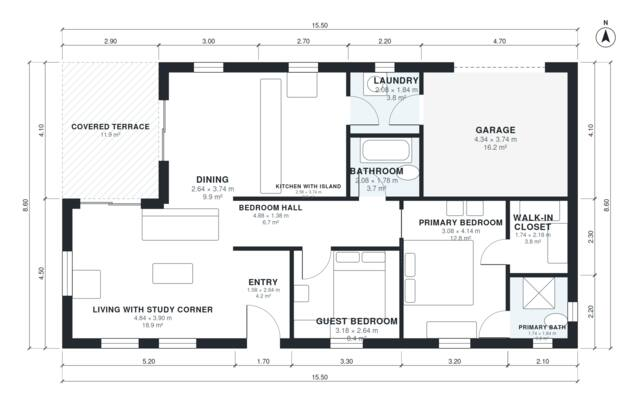

# 2 Bedroom House Plan 100 m2 | 1,100 Sq Ft Single Story

This is a compact single-storey home of about 100 m² of living space on a 15.5 x 8.6 m footprint. The open kitchen with island, dining and living area (with a study corner) opens onto a 12 m² covered terrace. A bedroom hall leads to the primary suite with ensuite and walk-in closet, a guest bedroom and a shared bath. The laundry links the kitchen to the attached 1-car garage.

| | |
|---|---|
| Levels | 1 |
| Footprint | 15.5 m × 8.6 m (51 ft × 28 ft) |
| Rooms | 12 indoor, 1 outdoor |
| Indoor area including garage, from the room grid | about 121 m² (1,307 sq ft) |

## Files here

- `area-schedule.csv` (room schedule)
- `building.json` (rooms, walls, openings as data)
- `plan-level1.dxf` (floor plan, DXF, drawing units: millimetres)

## More for this plan

- Plan page with the PDF plan set, IFC and 3D model, and a tool to change the plan: https://floorplan.ai-architectures.com/house-plans/2-bedroom-house-plan-100-m2?utm_source=github-plans&utm_medium=probe&utm_campaign=github
- PDF plan set: https://storage.googleapis.com/20img/house-plans/2-bedroom-house-plan-100-m2/plan-set.pdf
- IFC model: https://storage.googleapis.com/20img/house-plans/2-bedroom-house-plan-100-m2/model.ifc

## Known issues in this drawing

- Primary Bath is 3.2 m² (asked for about 5.0 m²).

Concept design generated with AI. Not for construction or permit; verify with a licensed professional.
