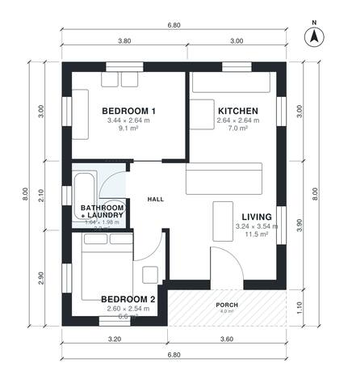

# 2 Bedroom House Plans 50 m2: 540 Sq Ft Compact Single-Story

A compact single-storey casita of about 54 m² including the porch, with about 50 m² of interior. The entrance opens from a small porch into an open kitchen and living area. A short hall leads to two bedrooms and a bathroom with a laundry corner. The plan is efficient with no wasted corridor. The bedrooms and kitchen are a little smaller than first requested, and we can adjust them if you want more room.

| | |
|---|---|
| Levels | 1 |
| Footprint | 6.8 m × 8.0 m (22 ft × 26 ft) |
| Rooms | 6 indoor, 1 outdoor |
| Indoor area including garage, from the room grid | about 50 m² (543 sq ft) |

## Files here

- `area-schedule.csv` (room schedule)
- `building.json` (rooms, walls, openings as data)
- `plan-level1.dxf` (floor plan, DXF, drawing units: millimetres)

## More for this plan

- Plan page with the PDF plan set, IFC and 3D model, and a tool to change the plan: https://floorplan.ai-architectures.com/house-plans/2-bedroom-house-plan-50-m2?utm_source=github-plans&utm_medium=probe&utm_campaign=github
- PDF plan set: https://storage.googleapis.com/20img/house-plans/2-bedroom-house-plan-50-m2/plan-set.pdf
- IFC model: https://storage.googleapis.com/20img/house-plans/2-bedroom-house-plan-50-m2/model.ifc

## Known issues in this drawing

- Bathroom + Laundry is 3.2 m² (asked for about 5.0 m²).
- Bedroom 1 is only 2.64 m wide.

Concept design generated with AI. Not for construction or permit; verify with a licensed professional.
