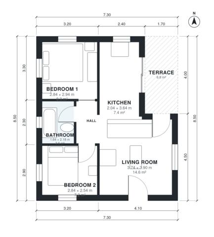

# 2 Bedroom House Plan 55 m2 | 590 Sq Ft, 1 Bath, Single Story

A compact single-storey home of about 55 m² of living space inside a 9.5 x 6.5 m footprint, plus a small front terrace. An open kitchen and living area sits at the front and west, with two bedrooms and a bathroom off a short hall. There is no garage and no basement, as you asked.

| | |
|---|---|
| Levels | 1 |
| Footprint | 7.3 m × 8.5 m (24 ft × 28 ft) |
| Rooms | 6 indoor, 1 outdoor |
| Indoor area including garage, from the room grid | about 55 m² (595 sq ft) |

## Files here

- `area-schedule.csv` (room schedule)
- `building.json` (rooms, walls, openings as data)
- `plan-level1.dxf` (floor plan, DXF, drawing units: millimetres)

## More for this plan

- Plan page with the PDF plan set, IFC and 3D model, and a tool to change the plan: https://floorplan.ai-architectures.com/house-plans/2-bedroom-house-plan-55-m2?utm_source=github-plans&utm_medium=probe&utm_campaign=github
- PDF plan set: https://storage.googleapis.com/20img/house-plans/2-bedroom-house-plan-55-m2/plan-set.pdf
- IFC model: https://storage.googleapis.com/20img/house-plans/2-bedroom-house-plan-55-m2/model.ifc

## Known issues in this drawing

- Bedroom 1 is only 2.84 m wide.
- Kitchen is only 2.04 m wide.

Concept design generated with AI. Not for construction or permit; verify with a licensed professional.
