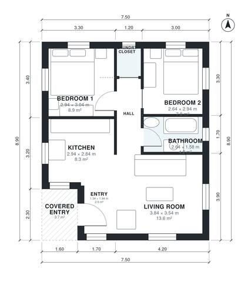

# 2 Bedroom House Plan 65 m² | 680 Sq Ft Single-Story Layout

This is a compact single-storey 2-bedroom home of about 63 m² indoors, plus a 3.9 m² covered entry. A central hall serves both bedrooms, the shared bathroom and the laundry closet. The kitchen and living room form a single open space with windows on the south and east sides.

| | |
|---|---|
| Levels | 1 |
| Footprint | 7.5 m × 8.9 m (25 ft × 29 ft) |
| Rooms | 8 indoor, 1 outdoor |
| Indoor area including garage, from the room grid | about 63 m² (679 sq ft) |

## Files here

- `area-schedule.csv` (room schedule)
- `building.json` (rooms, walls, openings as data)
- `plan-level1.dxf` (floor plan, DXF, drawing units: millimetres)

## More for this plan

- Plan page with the PDF plan set, IFC and 3D model, and a tool to change the plan: https://floorplan.ai-architectures.com/house-plans/2-bedroom-house-plan-65-m2?utm_source=github-plans&utm_medium=probe&utm_campaign=github
- PDF plan set: https://storage.googleapis.com/20img/house-plans/2-bedroom-house-plan-65-m2/plan-set.pdf
- IFC model: https://storage.googleapis.com/20img/house-plans/2-bedroom-house-plan-65-m2/model.ifc

## Known issues in this drawing

- Entry is 2.6 m² (asked for about 4.0 m²).

Concept design generated with AI. Not for construction or permit; verify with a licensed professional.
