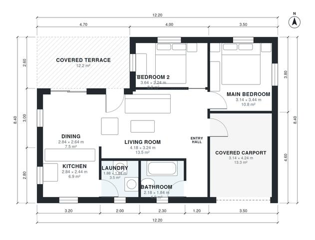

# 2 Bedroom House Plan 75 m2: 800 sq ft Single-Story Layout

A compact single-storey 2-bedroom, 1-bath home of about 75 m² of living space. The kitchen, dining and living areas are open to each other and to a covered terrace. A one-car carport is attached, with a direct door to the entry hall. The revision gives the living area more room, trims the circulation and outdoor areas, and brings the laundry closer to its intended size.

| | |
|---|---|
| Levels | 1 |
| Footprint | 12.2 m × 8.4 m (40 ft × 28 ft) |
| Rooms | 9 indoor, 1 outdoor |
| Indoor area including garage, from the room grid | about 90 m² (972 sq ft) |

## Files here

- `area-schedule.csv` (room schedule)
- `building.json` (rooms, walls, openings as data)
- `plan-level1.dxf` (floor plan, DXF, drawing units: millimetres)

## More for this plan

- Plan page with the PDF plan set, IFC and 3D model, and a tool to change the plan: https://floorplan.ai-architectures.com/house-plans/2-bedroom-house-plan-75-m2?utm_source=github-plans&utm_medium=probe&utm_campaign=github
- PDF plan set: https://storage.googleapis.com/20img/house-plans/2-bedroom-house-plan-75-m2/plan-set.pdf
- IFC model: https://storage.googleapis.com/20img/house-plans/2-bedroom-house-plan-75-m2/model.ifc

## Known issues in this drawing

- Living Room is 13.5 m² (asked for about 20.0 m²).
- Living Room has no window.
- Bedroom 2 is only 2.24 m wide.

Concept design generated with AI. Not for construction or permit; verify with a licensed professional.
