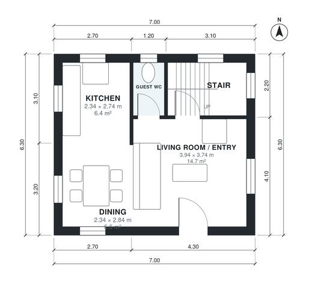

# 2 Bedroom House Plan 85 m2: 950 Sq Ft Two-Story Layout

A compact two-storey home of about 88 m² (7.0 x 6.3 m per floor), with no garage and no basement. The ground floor is an open living, dining and kitchen area with a guest WC and the stair by the entrance. Upstairs are two bedrooms and a shared bath around a central landing.

| | |
|---|---|
| Levels | 2 |
| Footprint | 7.0 m × 6.3 m (23 ft × 21 ft) |
| Rooms | 10 indoor, 0 outdoor |
| Indoor area including garage, from the room grid | about 88 m² (949 sq ft) |

## Files here

- `area-schedule.csv` (room schedule)
- `building.json` (rooms, walls, openings as data)
- `plan-level1.dxf` (floor plan, DXF, drawing units: millimetres)
- `plan-level2.dxf` (floor plan, DXF, drawing units: millimetres)

## More for this plan

- Plan page with the PDF plan set, IFC and 3D model, and a tool to change the plan: https://floorplan.ai-architectures.com/house-plans/2-bedroom-house-plan-85-m2?utm_source=github-plans&utm_medium=probe&utm_campaign=github
- PDF plan set: https://storage.googleapis.com/20img/house-plans/2-bedroom-house-plan-85-m2/plan-set.pdf
- IFC model: https://storage.googleapis.com/20img/house-plans/2-bedroom-house-plan-85-m2/model.ifc

## Known issues in this drawing

- Landing and Bedroom 2 are not directly connected.
- Dining is only 2.34 m wide.

Concept design generated with AI. Not for construction or permit; verify with a licensed professional.
