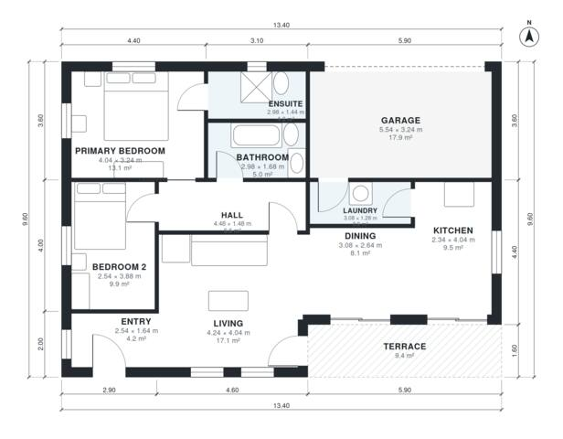

# 2 Bedroom House Plan 95 m2: 1,050 Sq Ft, 2 Bath, 1-Car Garage

A compact single-storey contemporary home of about 98 m² of living space, plus a 21 m² one-car garage and a terrace. It has an open kitchen, dining and living area that opens to the terrace. Two bedrooms sit off a short hall, with the primary suite at the end, and the garage connects through the laundry.

| | |
|---|---|
| Levels | 1 |
| Footprint | 13.4 m × 9.6 m (44 ft × 31 ft) |
| Rooms | 11 indoor, 1 outdoor |
| Indoor area including garage, from the room grid | about 119 m² (1,283 sq ft) |

## Files here

- `area-schedule.csv` (room schedule)
- `building.json` (rooms, walls, openings as data)
- `plan-level1.dxf` (floor plan, DXF, drawing units: millimetres)

## More for this plan

- Plan page with the PDF plan set, IFC and 3D model, and a tool to change the plan: https://floorplan.ai-architectures.com/house-plans/2-bedroom-house-plan-95-m2?utm_source=github-plans&utm_medium=probe&utm_campaign=github
- PDF plan set: https://storage.googleapis.com/20img/house-plans/2-bedroom-house-plan-95-m2/plan-set.pdf
- IFC model: https://storage.googleapis.com/20img/house-plans/2-bedroom-house-plan-95-m2/model.ifc

## Known issues in this drawing

- Bedroom 2 is only 2.54 m wide.
- Ensuite is only 1.44 m wide.
- Laundry is only 1.28 m wide.

Concept design generated with AI. Not for construction or permit; verify with a licensed professional.
