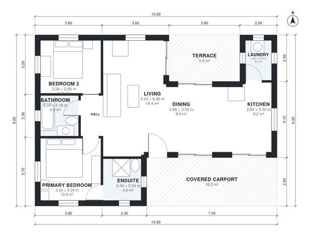

# 2 Bedroom House Plans with Carport: 990 Sq Ft Single Story

A compact single-storey home of about 92 m² indoors, plus a covered one-car carport at the front and a rear terrace. Kitchen, dining and living are open to each other. A short hall serves the two bedrooms and the bathroom, and the primary bedroom has its own ensuite. The revision moves area from the living room into the laundry, bedroom 2 and the bathrooms so they are usable.

| | |
|---|---|
| Levels | 1 |
| Footprint | 13.0 m × 9.2 m (43 ft × 30 ft) |
| Rooms | 9 indoor, 2 outdoor |
| Indoor area including garage, from the room grid | about 92 m² (989 sq ft) |

## Files here

- `area-schedule.csv` (room schedule)
- `building.json` (rooms, walls, openings as data)
- `plan-level1.dxf` (floor plan, DXF, drawing units: millimetres)

## More for this plan

- Plan page with the PDF plan set, IFC and 3D model, and a tool to change the plan: https://floorplan.ai-architectures.com/house-plans/2-bedroom-house-plans-with-carport?utm_source=github-plans&utm_medium=probe&utm_campaign=github
- PDF plan set: https://storage.googleapis.com/20img/house-plans/2-bedroom-house-plans-with-carport/plan-set.pdf
- IFC model: https://storage.googleapis.com/20img/house-plans/2-bedroom-house-plans-with-carport/model.ifc

## Known issues in this drawing

- Laundry is 3.0 m² (asked for about 5.0 m²).

Concept design generated with AI. Not for construction or permit; verify with a licensed professional.
