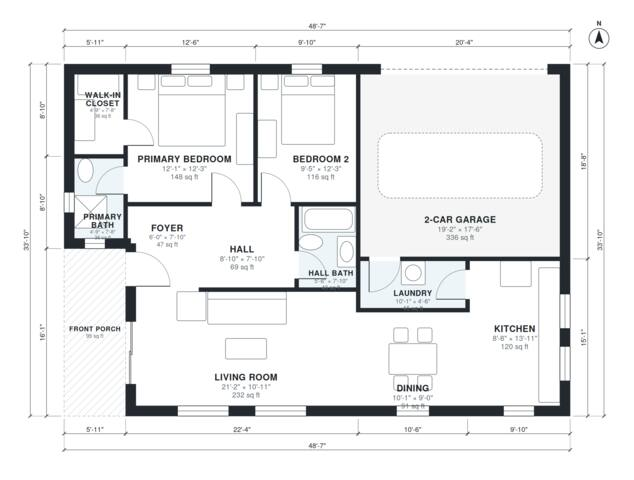

# 2 Bedroom House Plans With Garage: 1,170 Sq Ft, 2 Bath

This is a single-story 2-bedroom, 2-bath ranch with about 1,200 sq ft of living space, plus a 2-car garage and a covered front porch. The kitchen, dining and living room are open to each other along the south side. The two bedrooms and the hall bath open off a central hall, and the primary suite has its own bath and walk-in closet. The garage enters through the laundry into the kitchen. If you want, the primary bath and closet can be made a bit roomier.

| | |
|---|---|
| Levels | 1 |
| Footprint | 14.8 m × 10.3 m (49 ft × 34 ft) |
| Rooms | 12 indoor, 1 outdoor |
| Indoor area including garage, from the room grid | about 144 m² (1,546 sq ft) |

## Files here

- `area-schedule.csv` (room schedule)
- `building.json` (rooms, walls, openings as data)
- `plan-level1.dxf` (floor plan, DXF, drawing units: inches)

## More for this plan

- Plan page with the PDF plan set, IFC and 3D model, and a tool to change the plan: https://floorplan.ai-architectures.com/house-plans/2-bedroom-house-plans-with-garage?utm_source=github-plans&utm_medium=probe&utm_campaign=github
- PDF plan set: https://storage.googleapis.com/20img/house-plans/2-bedroom-house-plans-with-garage/plan-set.pdf
- IFC model: https://storage.googleapis.com/20img/house-plans/2-bedroom-house-plans-with-garage/model.ifc

## Known issues in this drawing

- Primary Bath is 3.4 m² (asked for about 6.0 m²).
- Primary Bath is only 1.44 m wide.

Concept design generated with AI. Not for construction or permit; verify with a licensed professional.
