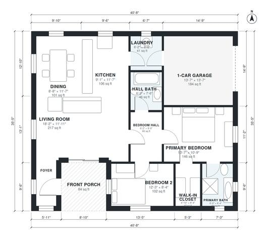

# 2 Bedroom House Plans: 1,140 Sq Ft Single-Story Design

This is a compact single-story 2-bedroom, 2-bath home of about 1,100 sq ft of heated space. The footprint is about 40'-8" x 35'-5", which includes the 1-car garage and front porch. A large open living, kitchen and dining area sits on the west side. The primary suite, with its own bath and walk-in closet, and the second bedroom open off a short private hall. The laundry connects the garage to the kitchen.

| | |
|---|---|
| Levels | 1 |
| Footprint | 12.4 m × 10.8 m (41 ft × 35 ft) |
| Rooms | 12 indoor, 1 outdoor |
| Indoor area including garage, from the room grid | about 126 m² (1,357 sq ft) |

## Files here

- `area-schedule.csv` (room schedule)
- `building.json` (rooms, walls, openings as data)
- `plan-level1.dxf` (floor plan, DXF, drawing units: inches)

## More for this plan

- Plan page with the PDF plan set, IFC and 3D model, and a tool to change the plan: https://floorplan.ai-architectures.com/house-plans/2-bedroom-house-plans?utm_source=github-plans&utm_medium=probe&utm_campaign=github
- PDF plan set: https://storage.googleapis.com/20img/house-plans/2-bedroom-house-plans/plan-set.pdf
- IFC model: https://storage.googleapis.com/20img/house-plans/2-bedroom-house-plans/model.ifc

## Known issues in this drawing

- Foyer is 3.0 m² (asked for about 5.0 m²).
- Foyer is only 1.20 m wide.

Concept design generated with AI. Not for construction or permit; verify with a licensed professional.
