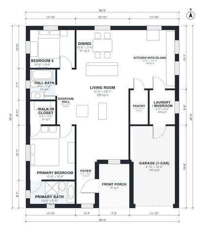

# 2 Bedroom Modern Farmhouse Plans: 1,270 Sq Ft, 2 Bath

This is a single-story modern farmhouse with about 116 m² (1,250 sq ft) of living space. The footprint is roughly 11 x 13 m including the 1-car garage and front porch. It has an open kitchen with island, dining and living area, a pantry, and a laundry/mudroom that links the kitchen to the garage. The primary suite (bath and walk-in closet) and Bedroom 2 with its hall bath are in a separate wing on the west side.

| | |
|---|---|
| Levels | 1 |
| Footprint | 11.1 m × 13.2 m (36 ft × 43 ft) |
| Rooms | 13 indoor, 1 outdoor |
| Indoor area including garage, from the room grid | about 139 m² (1,501 sq ft) |

## Files here

- `area-schedule.csv` (room schedule)
- `building.json` (rooms, walls, openings as data)
- `plan-level1.dxf` (floor plan, DXF, drawing units: inches)

## More for this plan

- Plan page with the PDF plan set, IFC and 3D model, and a tool to change the plan: https://floorplan.ai-architectures.com/house-plans/2-bedroom-modern-farmhouse-plans?utm_source=github-plans&utm_medium=probe&utm_campaign=github
- PDF plan set: https://storage.googleapis.com/20img/house-plans/2-bedroom-modern-farmhouse-plans/plan-set.pdf
- IFC model: https://storage.googleapis.com/20img/house-plans/2-bedroom-modern-farmhouse-plans/model.ifc

## Known issues in this drawing

- Dining is only 2.24 m wide.

Concept design generated with AI. Not for construction or permit; verify with a licensed professional.
