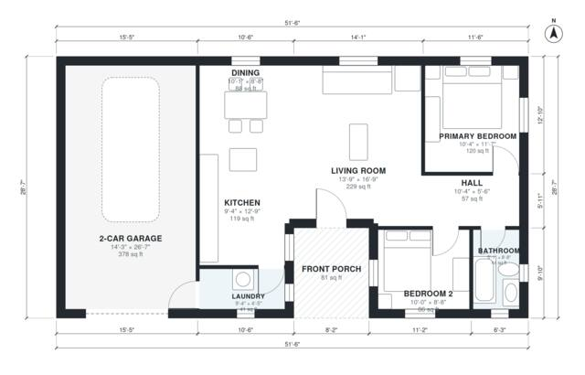

# 2 Bedroom Modern House Plans: 950 Sq Ft Single-Story Home

This is a single-story modern ranch of about 12.6 x 10.9 m with a side-attached 2-car garage and a front porch. The open kitchen, dining and living area has windows on the south and west walls. Two bedrooms and a shared bath sit off a short hall on the east side. The garage enters the house through the laundry next to the kitchen.

| | |
|---|---|
| Levels | 1 |
| Footprint | 15.7 m × 8.7 m (52 ft × 29 ft) |
| Rooms | 9 indoor, 1 outdoor |
| Indoor area including garage, from the room grid | about 129 m² (1,390 sq ft) |

## Files here

- `area-schedule.csv` (room schedule)
- `building.json` (rooms, walls, openings as data)
- `plan-level1.dxf` (floor plan, DXF, drawing units: inches)

## More for this plan

- Plan page with the PDF plan set, IFC and 3D model, and a tool to change the plan: https://floorplan.ai-architectures.com/house-plans/2-bedroom-modern-house-plans?utm_source=github-plans&utm_medium=probe&utm_campaign=github
- PDF plan set: https://storage.googleapis.com/20img/house-plans/2-bedroom-modern-house-plans/plan-set.pdf
- IFC model: https://storage.googleapis.com/20img/house-plans/2-bedroom-modern-house-plans/model.ifc

## Known issues in this drawing

- Laundry is 3.8 m² (asked for about 5.5 m²).
- Bedroom 2 is 8.0 m² (asked for about 11.0 m²).
- Bathroom is 4.1 m² (asked for about 5.5 m²).

Concept design generated with AI. Not for construction or permit; verify with a licensed professional.
