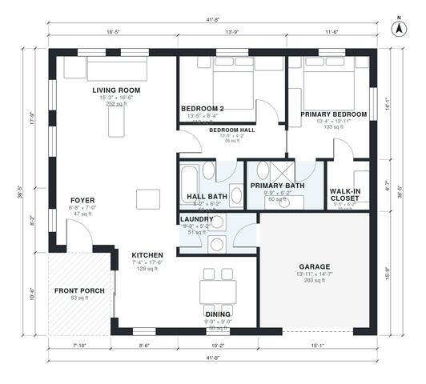

# 2 Bedroom Ranch House Plans: 1,200 Sq Ft with 1-Car Garage

This is a compact single-story ranch with about 1,230 sq ft of living space, plus a 1-car garage and a covered front porch. The open kitchen, dining and living area sits at the front and centre of the house. A private bedroom wing holds the primary suite, with its bath and walk-in closet, and a second bedroom beside the hall bath. The garage enters through the laundry, which acts as a mudroom.

| | |
|---|---|
| Levels | 1 |
| Footprint | 12.7 m × 11.1 m (42 ft × 36 ft) |
| Rooms | 12 indoor, 1 outdoor |
| Indoor area including garage, from the room grid | about 133 m² (1,435 sq ft) |

## Files here

- `area-schedule.csv` (room schedule)
- `building.json` (rooms, walls, openings as data)
- `plan-level1.dxf` (floor plan, DXF, drawing units: inches)

## More for this plan

- Plan page with the PDF plan set, IFC and 3D model, and a tool to change the plan: https://floorplan.ai-architectures.com/house-plans/2-bedroom-ranch-house-plans?utm_source=github-plans&utm_medium=probe&utm_campaign=github
- PDF plan set: https://storage.googleapis.com/20img/house-plans/2-bedroom-ranch-house-plans/plan-set.pdf
- IFC model: https://storage.googleapis.com/20img/house-plans/2-bedroom-ranch-house-plans/model.ifc

## Known issues in this drawing

- None found by the automatic checks.

Concept design generated with AI. Not for construction or permit; verify with a licensed professional.
