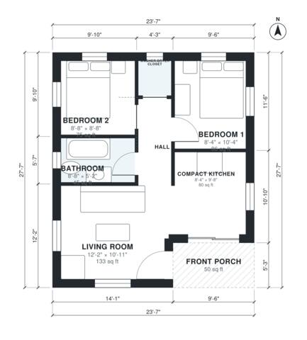

# 2 Bedroom Tiny House Plans: 600 Sq Ft Single-Level Layout

This is a compact one-storey tiny house of about 600 sq ft (56 m²) indoors, plus a 50 sq ft front porch. The porch opens into an open-plan living room and kitchen. A central hall leads to two small bedrooms, a full bath and a closet with a stacked washer/dryer. Every room has daylight, and the layout wastes little space.

| | |
|---|---|
| Levels | 1 |
| Footprint | 7.2 m × 8.4 m (24 ft × 28 ft) |
| Rooms | 7 indoor, 1 outdoor |
| Indoor area including garage, from the room grid | about 56 m² (601 sq ft) |

## Files here

- `area-schedule.csv` (room schedule)
- `building.json` (rooms, walls, openings as data)
- `plan-level1.dxf` (floor plan, DXF, drawing units: inches)

## More for this plan

- Plan page with the PDF plan set, IFC and 3D model, and a tool to change the plan: https://floorplan.ai-architectures.com/house-plans/2-bedroom-tiny-house-plans?utm_source=github-plans&utm_medium=probe&utm_campaign=github
- PDF plan set: https://storage.googleapis.com/20img/house-plans/2-bedroom-tiny-house-plans/plan-set.pdf
- IFC model: https://storage.googleapis.com/20img/house-plans/2-bedroom-tiny-house-plans/model.ifc

## Known issues in this drawing

- Living Room is 12.4 m² (asked for about 17.0 m²).
- Washer/Dryer Closet is only 1.18 m wide.

Concept design generated with AI. Not for construction or permit; verify with a licensed professional.
