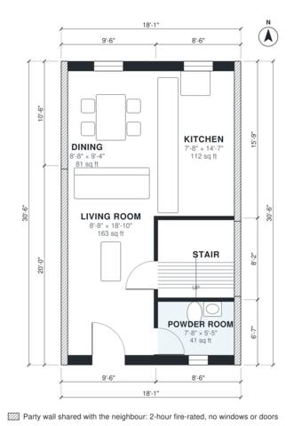

# 2 Bedroom Townhouse Plans: 1,100 Sq Ft, 18 Ft Wide, 2.5 Bath

A mid-terrace two-storey townhouse, 5.5 m (18 ft) wide and about 102 m² (1,100 sq ft) in total, with party walls on both long sides and windows only at the front and rear. The ground floor is a front living room that works as the entry, a kitchen and dining area at the rear, and a powder room beside the stair. Upstairs are two bedrooms, each with its own bath, and a laundry closet off the hall. Built against the neighbours on the left and right (party walls, fire wall without windows or doors); the rooms take their daylight from the free sides.

| | |
|---|---|
| Levels | 2 |
| Footprint | 5.5 m × 9.3 m (18 ft × 31 ft) |
| Rooms | 12 indoor, 0 outdoor |
| Indoor area including garage, from the room grid | about 102 m² (1,101 sq ft) |

## Files here

- `area-schedule.csv` (room schedule)
- `building.json` (rooms, walls, openings as data)
- `plan-level1.dxf` (floor plan, DXF, drawing units: inches)
- `plan-level2.dxf` (floor plan, DXF, drawing units: inches)

## More for this plan

- Plan page with the PDF plan set, IFC and 3D model, and a tool to change the plan: https://floorplan.ai-architectures.com/house-plans/2-bedroom-townhouse-plans?utm_source=github-plans&utm_medium=probe&utm_campaign=github
- PDF plan set: https://storage.googleapis.com/20img/house-plans/2-bedroom-townhouse-plans/plan-set.pdf
- IFC model: https://storage.googleapis.com/20img/house-plans/2-bedroom-townhouse-plans/model.ifc

## Known issues in this drawing

- Living Room is only 2.64 m wide.
- Living Room has no window.
- Bath 1 is only 1.44 m wide.

Concept design generated with AI. Not for construction or permit; verify with a licensed professional.
