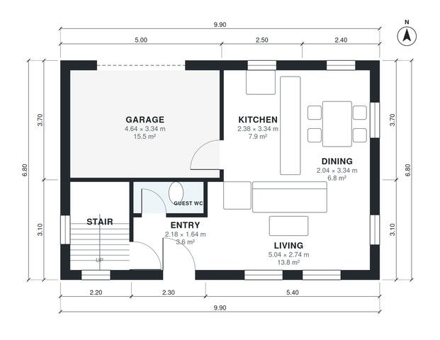

# 2 Bedroom Two Story House Plans With Garage | 1,040 Sq Ft

A compact two-storey home of about 94 m² of living space, plus a 1-car attached garage. The ground floor has an open kitchen, dining and living area, a guest WC and a small entry with the stair. Upstairs are two bedrooms, a bathroom and a laundry off a central hall.

| | |
|---|---|
| Levels | 2 |
| Footprint | 9.9 m × 6.8 m (32 ft × 22 ft) |
| Rooms | 13 indoor, 1 outdoor |
| Indoor area including garage, from the room grid | about 115 m² (1,237 sq ft) |

## Files here

- `area-schedule.csv` (room schedule)
- `building.json` (rooms, walls, openings as data)
- `plan-level1.dxf` (floor plan, DXF, drawing units: millimetres)
- `plan-level2.dxf` (floor plan, DXF, drawing units: millimetres)

## More for this plan

- Plan page with the PDF plan set, IFC and 3D model, and a tool to change the plan: https://floorplan.ai-architectures.com/house-plans/2-bedroom-two-story-house-plans-with-garage?utm_source=github-plans&utm_medium=probe&utm_campaign=github
- PDF plan set: https://storage.googleapis.com/20img/house-plans/2-bedroom-two-story-house-plans-with-garage/plan-set.pdf
- IFC model: https://storage.googleapis.com/20img/house-plans/2-bedroom-two-story-house-plans-with-garage/model.ifc

## Known issues in this drawing

- Dining is only 2.04 m wide.
- Living is only 2.74 m wide.
- Laundry is 2.5 m² (asked for about 3.5 m²).

Concept design generated with AI. Not for construction or permit; verify with a licensed professional.
