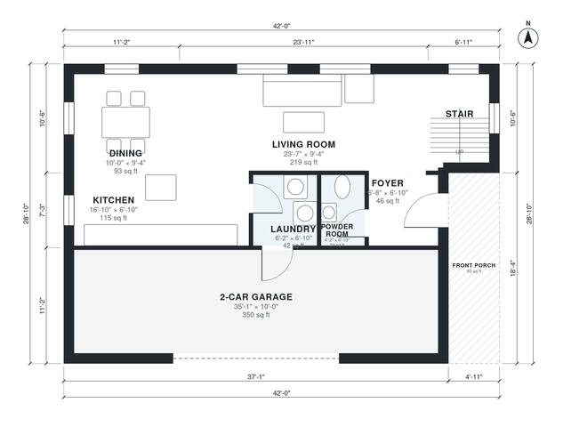

# 2 Bedroom Two Story House Plans: 1,400 Sq Ft with Garage

This is a compact two-story home of about 130 m² (1,400 sq ft) of living space, plus a 2-car garage and a front porch. The ground floor has an open kitchen, dining and living area, a powder room and a laundry room that doubles as the garage entry. Upstairs are a primary bedroom with a walk-in closet, a second bedroom and a full bath off a central hall.

| | |
|---|---|
| Levels | 2 |
| Footprint | 12.8 m × 8.8 m (42 ft × 29 ft) |
| Rooms | 14 indoor, 2 outdoor |
| Indoor area including garage, from the room grid | about 168 m² (1,814 sq ft) |

## Files here

- `area-schedule.csv` (room schedule)
- `building.json` (rooms, walls, openings as data)
- `plan-level1.dxf` (floor plan, DXF, drawing units: inches)
- `plan-level2.dxf` (floor plan, DXF, drawing units: inches)

## More for this plan

- Plan page with the PDF plan set, IFC and 3D model, and a tool to change the plan: https://floorplan.ai-architectures.com/house-plans/2-bedroom-two-story-house-plans?utm_source=github-plans&utm_medium=probe&utm_campaign=github
- PDF plan set: https://storage.googleapis.com/20img/house-plans/2-bedroom-two-story-house-plans/plan-set.pdf
- IFC model: https://storage.googleapis.com/20img/house-plans/2-bedroom-two-story-house-plans/model.ifc

## Known issues in this drawing

- Kitchen is only 2.08 m wide.
- Living Room is only 2.84 m wide.
- Walk-in Closet is 3.4 m² (asked for about 5.0 m²).

Concept design generated with AI. Not for construction or permit; verify with a licensed professional.
