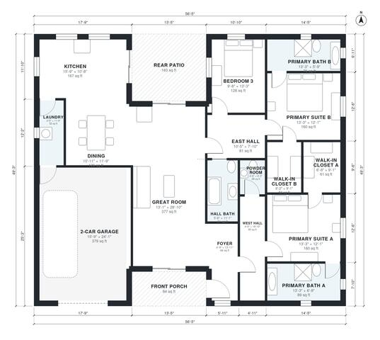

# 2 Master Bedroom House Plans: 2,080 Sq Ft Single-Story

This single-story ranch has about 195 m² (roughly 2,100 sq ft) of living space. It has a primary suite at each end, each with a walk-in closet and private bath. The open kitchen, dining and great room sit in the middle and open to a rear patio. A third bedroom, a hall bath, a powder room, laundry and a 2-car garage entered through the laundry complete the plan.

| | |
|---|---|
| Levels | 1 |
| Footprint | 17.2 m × 15.0 m (56 ft × 49 ft) |
| Rooms | 17 indoor, 2 outdoor |
| Indoor area including garage, from the room grid | about 235 m² (2,530 sq ft) |

## Files here

- `area-schedule.csv` (room schedule)
- `building.json` (rooms, walls, openings as data)
- `plan-level1.dxf` (floor plan, DXF, drawing units: inches)

## More for this plan

- Plan page with the PDF plan set, IFC and 3D model, and a tool to change the plan: https://floorplan.ai-architectures.com/house-plans/2-master-bedroom-house-plans?utm_source=github-plans&utm_medium=probe&utm_campaign=github
- PDF plan set: https://storage.googleapis.com/20img/house-plans/2-master-bedroom-house-plans/plan-set.pdf
- IFC model: https://storage.googleapis.com/20img/house-plans/2-master-bedroom-house-plans/model.ifc

## Known issues in this drawing

- Dining has no window.

Concept design generated with AI. Not for construction or permit; verify with a licensed professional.
