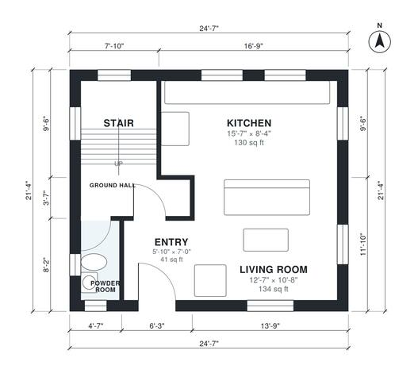

# 2 Story ADU Plans: 1,050 Sq Ft, 2 Bed, 1.5 Bath Detached

This is a compact two-story detached ADU of about 95 m² (roughly 1,020 sq ft) on a 7.5 x 6.5 m footprint. Downstairs has an entry, an open kitchen and living room, a powder room and the stair. Upstairs has a primary bedroom, a second bedroom, a bathroom and a laundry, all off a central hall.

| | |
|---|---|
| Levels | 2 |
| Footprint | 7.5 m × 6.5 m (25 ft × 21 ft) |
| Rooms | 12 indoor, 0 outdoor |
| Indoor area including garage, from the room grid | about 98 m² (1,049 sq ft) |

## Files here

- `area-schedule.csv` (room schedule)
- `building.json` (rooms, walls, openings as data)
- `plan-level1.dxf` (floor plan, DXF, drawing units: inches)
- `plan-level2.dxf` (floor plan, DXF, drawing units: inches)

## More for this plan

- Plan page with the PDF plan set, IFC and 3D model, and a tool to change the plan: https://floorplan.ai-architectures.com/house-plans/2-story-adu-plans?utm_source=github-plans&utm_medium=probe&utm_campaign=github
- PDF plan set: https://storage.googleapis.com/20img/house-plans/2-story-adu-plans/plan-set.pdf
- IFC model: https://storage.googleapis.com/20img/house-plans/2-story-adu-plans/model.ifc

## Known issues in this drawing

- Living Room is 12.4 m² (asked for about 20.0 m²).
- Bathroom is 3.3 m² (asked for about 5.0 m²).

Concept design generated with AI. Not for construction or permit; verify with a licensed professional.
