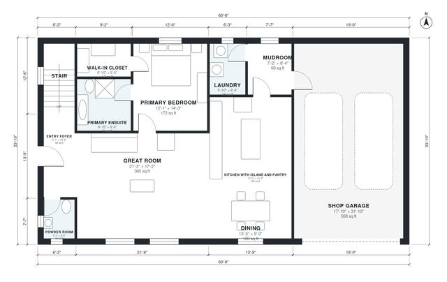

# 2 Story Barndominium Floor Plans | 3 Bed, 2,160 Sq Ft

A rectangular two-story barndominium with roughly 2,150 sq ft of living space plus an attached shop garage. The ground floor has an open great room with a kitchen island and dining area, a primary suite with walk-in closet and ensuite, a powder room, laundry, and a mudroom that leads to the garage. Upstairs are two bedrooms, a bath and a loft at the top of the stair.

| | |
|---|---|
| Levels | 2 |
| Footprint | 18.5 m × 10.3 m (61 ft × 34 ft) |
| Rooms | 18 indoor, 1 outdoor |
| Indoor area including garage, from the room grid | about 261 m² (2,808 sq ft) |

## Files here

- `area-schedule.csv` (room schedule)
- `building.json` (rooms, walls, openings as data)
- `plan-level1.dxf` (floor plan, DXF, drawing units: inches)
- `plan-level2.dxf` (floor plan, DXF, drawing units: inches)

## More for this plan

- Plan page with the PDF plan set, IFC and 3D model, and a tool to change the plan: https://floorplan.ai-architectures.com/house-plans/2-story-barndominium-floor-plans?utm_source=github-plans&utm_medium=probe&utm_campaign=github
- PDF plan set: https://storage.googleapis.com/20img/house-plans/2-story-barndominium-floor-plans/plan-set.pdf
- IFC model: https://storage.googleapis.com/20img/house-plans/2-story-barndominium-floor-plans/model.ifc

## Known issues in this drawing

- Kitchen with Island and Pantry has no window.
- Shop Garage is only 5.44 m wide.
- Bedroom 2 is only 2.14 m wide.

Concept design generated with AI. Not for construction or permit; verify with a licensed professional.
