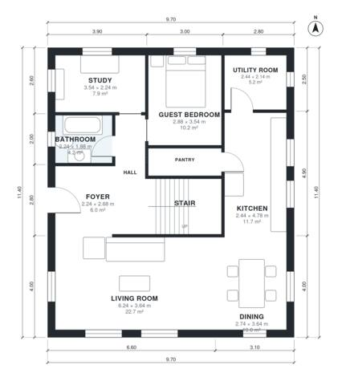

# 200 Square Meter House Plans: 4 Bed, 3 Bath, 2,040 Sq Ft

A compact two-storey home of about 208 m² on a 10.4 x 10 m footprint with no garage. Downstairs there is an open living, dining and kitchen area with a pantry, plus a study, a guest bedroom, a bathroom and a utility room. Upstairs there is a primary suite with ensuite and walk-in closet, two more bedrooms, a family bath and a loft sitting area around the landing.

| | |
|---|---|
| Levels | 2 |
| Footprint | 9.7 m × 11.4 m (32 ft × 37 ft) |
| Rooms | 19 indoor, 1 outdoor |
| Indoor area including garage, from the room grid | about 189 m² (2,037 sq ft) |

## Files here

- `area-schedule.csv` (room schedule)
- `building.json` (rooms, walls, openings as data)
- `plan-level1.dxf` (floor plan, DXF, drawing units: millimetres)
- `plan-level2.dxf` (floor plan, DXF, drawing units: millimetres)

## More for this plan

- Plan page with the PDF plan set, IFC and 3D model, and a tool to change the plan: https://floorplan.ai-architectures.com/house-plans/200-square-meter-house-plans?utm_source=github-plans&utm_medium=probe&utm_campaign=github
- PDF plan set: https://storage.googleapis.com/20img/house-plans/200-square-meter-house-plans/plan-set.pdf
- IFC model: https://storage.googleapis.com/20img/house-plans/200-square-meter-house-plans/model.ifc

## Known issues in this drawing

- Bedroom 2 is only 2.34 m wide.

Concept design generated with AI. Not for construction or permit; verify with a licensed professional.
