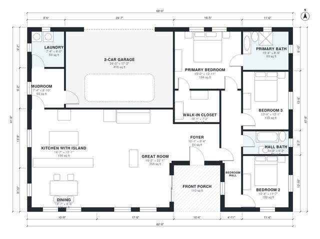

# 2000 Sq Ft 3 Bedroom House Plans: One-Story, 2-Car Garage

This is a single-story, open-plan farmhouse of about 185 m² (2,000 sq ft) of living space, plus a 2-car garage and a covered front porch. The kitchen with island flows into the dining area and a large great room. The primary suite with a bath and walk-in closet is separate from the two other bedrooms, which share a hall bath. A mudroom and laundry connect the garage to the kitchen.

| | |
|---|---|
| Levels | 1 |
| Footprint | 18.3 m × 12.7 m (60 ft × 42 ft) |
| Rooms | 14 indoor, 1 outdoor |
| Indoor area including garage, from the room grid | about 222 m² (2,391 sq ft) |

## Files here

- `area-schedule.csv` (room schedule)
- `building.json` (rooms, walls, openings as data)
- `plan-level1.dxf` (floor plan, DXF, drawing units: inches)

## More for this plan

- Plan page with the PDF plan set, IFC and 3D model, and a tool to change the plan: https://floorplan.ai-architectures.com/house-plans/2000-sq-ft-3-bedroom-house-plans?utm_source=github-plans&utm_medium=probe&utm_campaign=github
- PDF plan set: https://storage.googleapis.com/20img/house-plans/2000-sq-ft-3-bedroom-house-plans/plan-set.pdf
- IFC model: https://storage.googleapis.com/20img/house-plans/2000-sq-ft-3-bedroom-house-plans/model.ifc

## Known issues in this drawing

- None found by the automatic checks.

Concept design generated with AI. Not for construction or permit; verify with a licensed professional.
