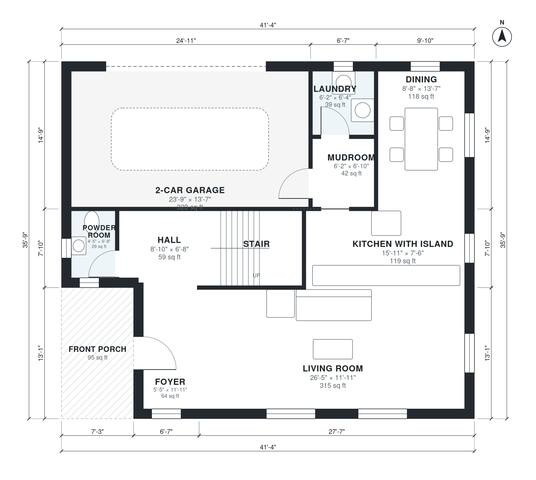

# 2000 Sq Ft 4 Bedroom House Plans | 1,970 Sq Ft Two-Story Plan

This is a two-story, four-bedroom modern farmhouse of about 190 m² (about 2,040 sq ft) of living space, not counting the 2-car garage. The ground floor has a front porch and foyer, an open kitchen with island, dining and living area, and a mudroom and laundry beside the garage. Upstairs are the primary suite with ensuite bath and walk-in closet, three more bedrooms and a hall bath. A revision will give the powder room, laundry, hall bath and walk-in closet usable proportions.

| | |
|---|---|
| Levels | 2 |
| Footprint | 12.6 m × 10.9 m (41 ft × 36 ft) |
| Rooms | 19 indoor, 2 outdoor |
| Indoor area including garage, from the room grid | about 217 m² (2,334 sq ft) |

## Files here

- `area-schedule.csv` (room schedule)
- `building.json` (rooms, walls, openings as data)
- `plan-level1.dxf` (floor plan, DXF, drawing units: inches)
- `plan-level2.dxf` (floor plan, DXF, drawing units: inches)

## More for this plan

- Plan page with the PDF plan set, IFC and 3D model, and a tool to change the plan: https://floorplan.ai-architectures.com/house-plans/2000-sq-ft-4-bedroom-house-plans?utm_source=github-plans&utm_medium=probe&utm_campaign=github
- PDF plan set: https://storage.googleapis.com/20img/house-plans/2000-sq-ft-4-bedroom-house-plans/plan-set.pdf
- IFC model: https://storage.googleapis.com/20img/house-plans/2000-sq-ft-4-bedroom-house-plans/model.ifc

## Known issues in this drawing

- Laundry is 3.6 m² (asked for about 5.0 m²).
- Kitchen with Island is 11.0 m² (asked for about 16.0 m²).

Concept design generated with AI. Not for construction or permit; verify with a licensed professional.
