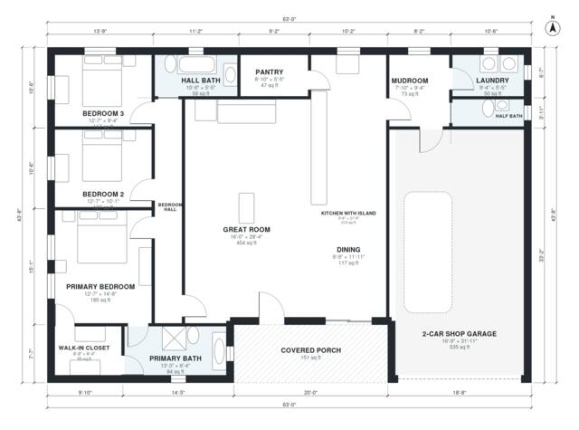

# 2000 Sq Ft Barndominium Floor Plans: 3 Bed, 2.5 Bath Plan

This is a single-story rectangular barndominium of roughly 186 m² (2,000 sq ft) of living space, plus a 56 m² two-car shop garage and a covered porch. A large open great room, kitchen with island and dining area sit in the middle. The primary suite, with its bath and walk-in closet, is at one end of the bedroom hall, with two more bedrooms and a hall bath. The mudroom links the shop to the kitchen, laundry, pantry and half bath.

| | |
|---|---|
| Levels | 1 |
| Footprint | 19.2 m × 13.3 m (63 ft × 44 ft) |
| Rooms | 15 indoor, 1 outdoor |
| Indoor area including garage, from the room grid | about 241 m² (2,598 sq ft) |

## Files here

- `area-schedule.csv` (room schedule)
- `building.json` (rooms, walls, openings as data)
- `plan-level1.dxf` (floor plan, DXF, drawing units: inches)

## More for this plan

- Plan page with the PDF plan set, IFC and 3D model, and a tool to change the plan: https://floorplan.ai-architectures.com/house-plans/2000-sq-ft-barndominium-floor-plans?utm_source=github-plans&utm_medium=probe&utm_campaign=github
- PDF plan set: https://storage.googleapis.com/20img/house-plans/2000-sq-ft-barndominium-floor-plans/plan-set.pdf
- IFC model: https://storage.googleapis.com/20img/house-plans/2000-sq-ft-barndominium-floor-plans/model.ifc

## Known issues in this drawing

- Walk-in Closet is 5.1 m² (asked for about 7.0 m²).
- Great Room has no window.

Concept design generated with AI. Not for construction or permit; verify with a licensed professional.
