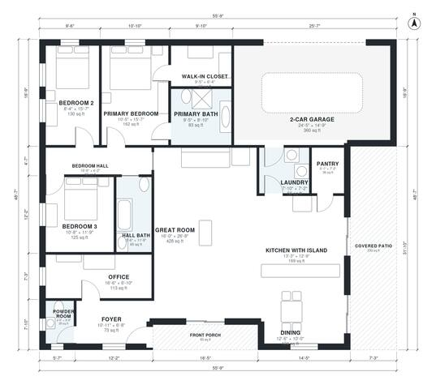

# 2000 sq ft House Plans: 3-Bed Single-Story Home with Office

This is a single-story, roughly 2,000 sq ft heated plan (about 186 m²) with a 2-car garage and covered patio added on. The foyer opens to a large open great room, kitchen with island and dining area. The dining area opens to the covered patio. A bedroom hall serves the primary suite (bath and walk-in closet) and two bedrooms that share a hall bath, with an office and powder room near the entry. The garage enters through the laundry into the kitchen.

| | |
|---|---|
| Levels | 1 |
| Footprint | 17.0 m × 14.8 m (56 ft × 49 ft) |
| Rooms | 16 indoor, 2 outdoor |
| Indoor area including garage, from the room grid | about 224 m² (2,414 sq ft) |

## Files here

- `area-schedule.csv` (room schedule)
- `building.json` (rooms, walls, openings as data)
- `plan-level1.dxf` (floor plan, DXF, drawing units: inches)

## More for this plan

- Plan page with the PDF plan set, IFC and 3D model, and a tool to change the plan: https://floorplan.ai-architectures.com/house-plans/2000-sq-ft-house-plans?utm_source=github-plans&utm_medium=probe&utm_campaign=github
- PDF plan set: https://storage.googleapis.com/20img/house-plans/2000-sq-ft-house-plans/plan-set.pdf
- IFC model: https://storage.googleapis.com/20img/house-plans/2000-sq-ft-house-plans/model.ifc

## Known issues in this drawing

- 2-Car Garage is only 4.50 m wide.

Concept design generated with AI. Not for construction or permit; verify with a licensed professional.
