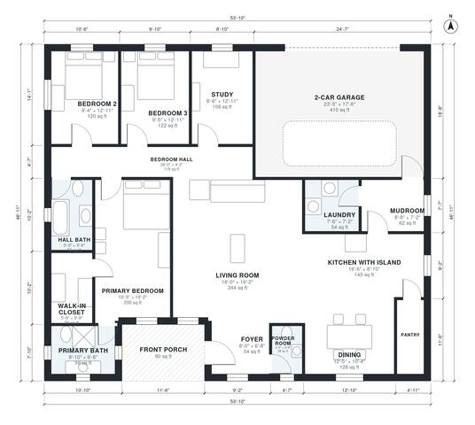

# 2000 Sq Ft Ranch House Plans: 3 Bed, 2.5 Bath, 2-Car Garage

This is a single-story ranch of about 186 m² (2,000 sq ft) of living space, plus a 2-car garage and a covered front porch. The porch enters a foyer and a central open great room, kitchen with island and dining area. The primary suite, two bedrooms and a study sit along a bedroom hall, and the mudroom, laundry and garage form a service zone off the kitchen.

| | |
|---|---|
| Levels | 1 |
| Footprint | 16.4 m × 14.3 m (54 ft × 47 ft) |
| Rooms | 17 indoor, 1 outdoor |
| Indoor area including garage, from the room grid | about 226 m² (2,434 sq ft) |

## Files here

- `area-schedule.csv` (room schedule)
- `building.json` (rooms, walls, openings as data)
- `plan-level1.dxf` (floor plan, DXF, drawing units: inches)

## More for this plan

- Plan page with the PDF plan set, IFC and 3D model, and a tool to change the plan: https://floorplan.ai-architectures.com/house-plans/2000-sq-ft-ranch-house-plans?utm_source=github-plans&utm_medium=probe&utm_campaign=github
- PDF plan set: https://storage.googleapis.com/20img/house-plans/2000-sq-ft-ranch-house-plans/plan-set.pdf
- IFC model: https://storage.googleapis.com/20img/house-plans/2000-sq-ft-ranch-house-plans/model.ifc

## Known issues in this drawing

- Primary Bath is 5.5 m² (asked for about 10.0 m²).
- Foyer is 5.0 m² (asked for about 7.0 m²).

Concept design generated with AI. Not for construction or permit; verify with a licensed professional.
