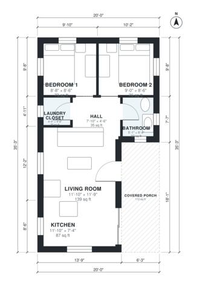

# 20x30 Cabin Floor Plans: 2 Bed, 1 Bath, 590 Sq Ft Design

This is a compact rustic cabin of about 600 sq ft (55.7 m²) indoors. The open kitchen and living area is at the front, and two small bedrooms, a bath and a laundry closet sit off a short hall at the back. A covered porch marks the front entrance. The revision shrinks the porch and keeps the main rooms from being squeezed.

| | |
|---|---|
| Levels | 1 |
| Footprint | 6.1 m × 10.74 m (20 ft × 35 ft) |
| Rooms | 7 indoor, 1 outdoor |
| Indoor area including garage, from the room grid | about 55 m² (593 sq ft) |

## Files here

- `area-schedule.csv` (room schedule)
- `building.json` (rooms, walls, openings as data)
- `plan-level1.dxf` (floor plan, DXF, drawing units: inches)

## More for this plan

- Plan page with the PDF plan set, IFC and 3D model, and a tool to change the plan: https://floorplan.ai-architectures.com/house-plans/20x30-cabin-floor-plans?utm_source=github-plans&utm_medium=probe&utm_campaign=github
- PDF plan set: https://storage.googleapis.com/20img/house-plans/20x30-cabin-floor-plans/plan-set.pdf
- IFC model: https://storage.googleapis.com/20img/house-plans/20x30-cabin-floor-plans/model.ifc

## Known issues in this drawing

- Living Room is 12.9 m² (asked for about 19.8 m²).
- Bathroom is 3.0 m² (asked for about 4.2 m²).

Concept design generated with AI. Not for construction or permit; verify with a licensed professional.
